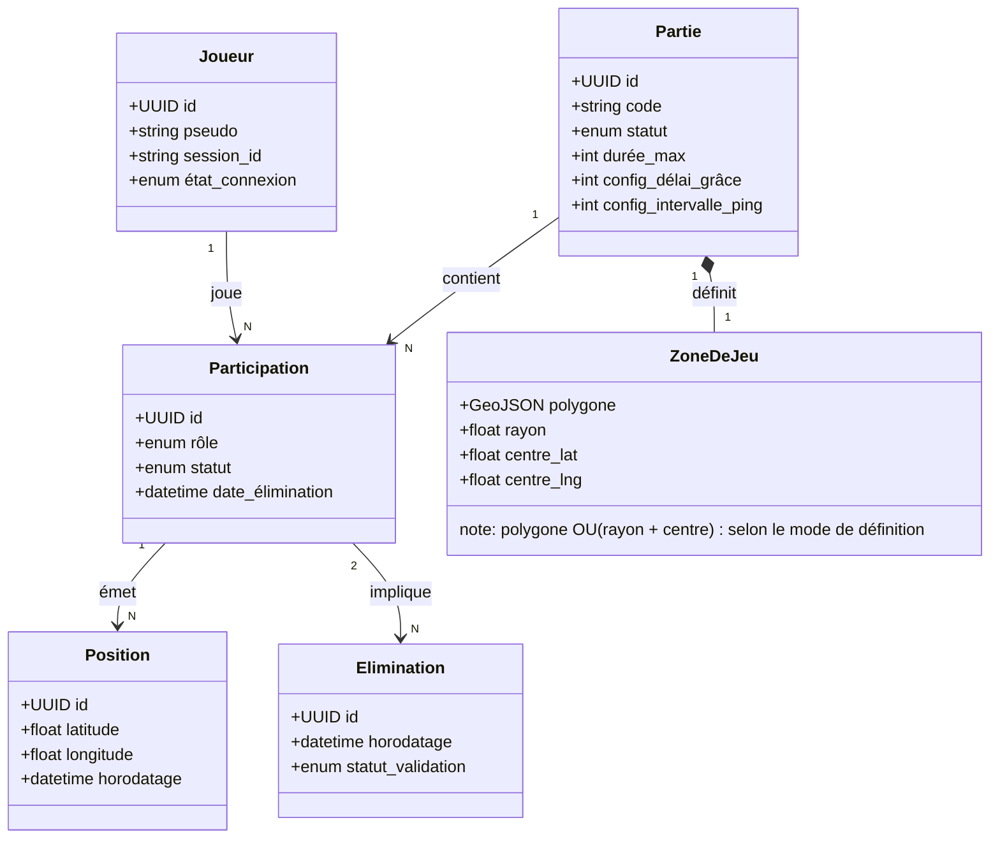

# Specification fonctionnelle ManHunt IRL

Sep 27, 2026 · @Anathos Elemental

Application web progressive (PWA) permettant à un groupe d'amis de jouer à ManHunt dans la vie réelle, avec géolocalisation en temps réel, rôles dynamiques et gestion de partie multijoueur, sans installation store.

## 1. Contexte et objectifs

### 1.1. Contexte

ManHunt IRL est une PWA (Progressive Web App) permettant à un groupe d'amis de rejouer le concept du jeu vidéo *Manhunt* (aussi appelé *The Hunt*) dans un espace physique réel. Un ou plusieurs joueurs incarnent des **Proies** qui tentent de rester libres dans une zone géographique définie ; les autres joueurs incarnent des **Chasseurs** qui cherchent à les localiser et les éliminer en les touchant physiquement.

Le besoin naît de l'absence d'outil simple, dédié et temps réel pour organiser ce type de partie informelle entre amis, sans avoir à recourir à des groupes WhatsApp, des appels téléphoniques ou du matériel externe.

## 2. Glossaire et modèle de données

### 2.1. Glossaire

| Terme | Définition |
| --- | --- |
| **Partie** | Session de jeu complète, de sa création à sa fin, identifiée par un code unique. |
| **Lobby** | Phase d'attente avant le début d'une Partie, pendant laquelle les Joueurs rejoignent et les paramètres sont configurés. |
| **Joueur** | Utilisateur participant à une Partie. Chaque Joueur possède un rôle actif (Chasseur ou Proie). |
| **Hôte** | Joueur ayant créé la Partie. Il est responsable des paramètres et du démarrage. |
| **Chasseur** *(Hunter)* | Rôle actif : cherche à localiser et à éliminer les Proies. Sa position est visible par les autres Chasseurs en temps réel continu. Il voit également la position des Proies à intervalle configurable (cf. RG-13). |
| **Proie** *(Prey)* | Rôle actif : cherche à rester libre jusqu'à la fin du temps imparti. Sa position est communiquée aux Chasseurs à intervalle configurable (cf. RG-13). |
| **Zone de jeu** | Périmètre géographique délimité (polygone ou rayon autour d'un point) dans lequel la Partie se déroule. |
| **Élimination** | Action par laquelle un Chasseur signale avoir touché physiquement une Proie, validant sa capture. |
| **Position** | Coordonnées GPS (latitude, longitude) d'un Joueur à un instant donné. |
| **Ping** | Signal périodique envoyé par l'application pour mettre à jour la Position d'un Joueur sur le serveur. |
| **Code de partie** | Identifiant court (4 caractères alphanumériques, sans caractères ambigus, insensible à la casse) permettant à un Joueur de rejoindre une Partie. |
| **Fin de partie** | État terminal déclenché automatiquement lorsque toutes les Proies sont éliminées ou que le chronomètre atteint zéro. |

### 2.2. Entités et attributs

| Entité | Attributs principaux |
| --- | --- |
| **Partie** | id, code (unique, court), statut (LOBBY / EN\_COURS / TERMINÉE), date\_création, date\_début, date\_fin, durée\_max (min), zone\_de\_jeu\_id (FK → ZoneDeJeu), config\_délai\_grâce (s), config\_intervalle\_ping (s) |
| **Joueur** | id, pseudo, session\_id (token opaque anonyme), état\_connexion (CONNECTÉ / DÉCONNECTÉ) |
| **Participation** | id, joueur\_id, partie\_id, rôle (CHASSEUR / PROIE), statut (LIBRE / ÉLIMINÉ), date\_élimination |
| **Position** | id, participation\_id, latitude, longitude, horodatage |
| **Élimination** | id, chasseur\_participation\_id, proie\_participation\_id, horodatage, statut\_validation (EN\_ATTENTE / CONFIRMÉE / CONTESTÉE) |

### 2.3. Relations

- Une **Partie** contient une ou plusieurs **Participations** (1 – N).
- Un **Joueur** peut avoir plusieurs **Participations** (une par Partie jouée) (1 – N).
- Une **Participation** est liée à plusieurs **Positions** (historique GPS) (1 – N).
- Une **Élimination** implique exactement deux **Participations** : un Chasseur et une Proie (N – 2).

### 2.4. Diagramme de classes



## 3. Règles de gestion

| ID | Intitulé | Description |
| --- | --- | --- |
| RG-01 | Unicité du code de partie | Le code de partie est généré aléatoirement et est unique parmi toutes les Parties en statut LOBBY ou EN\_COURS. |
| RG-02 | Nombre minimum de joueurs | Une Partie ne peut démarrer qu'avec au moins 2 Joueurs, dont au minimum 1 Chasseur et 1 Proie. |
| RG-03 | Nombre maximum de joueurs | Une Partie est limitée à 20 Joueurs simultanés. |
| RG-04 | Rôles mutuellement exclusifs | Un Joueur ne peut être à la fois Chasseur et Proie dans la même Partie. |
| RG-05 | Démarrage réservé à l'Hôte | Seul l'Hôte peut déclencher le démarrage de la Partie depuis le lobby. |
| RG-29 | Exclusion depuis le lobby | Dans le lobby uniquement, l'Hôte peut exclure un joueur (sauf lui-même) en deux appuis (« ✕ » puis « Exclure ? »). Le serveur retire le joueur, lui envoie `kicked`, ferme sa connexion et diffuse `player_removed`. Le joueur exclu revient à l'accueil avec un message ; il peut rejoindre à nouveau avec le code. |
| RG-30 | Liste des joueurs à jour | L'arrivée d'un joueur est diffusée dès sa requête HTTP de connexion (sans attendre son WebSocket). Les clients détectent les connexions mortes (sondage `ping`/`pong` toutes les 15 s, reconnexion si aucune réponse en 5 s) et demandent un état frais (`request_state`) au retour au premier plan. Côté serveur, la fermeture tardive d'un ancien socket n'affecte pas la nouvelle connexion du même joueur. |
| RG-31 | Relancer une partie | À la fin d'une Partie, l'Hôte peut « Relancer avec les mêmes joueurs » : retour au lobby avec les mêmes joueurs, rôles et configuration (zone, durées, rétrécissement, objectifs), modifiables avant de relancer. Éliminations, historique, pings, point de rendez-vous et complétion des objectifs sont réinitialisés ; l'intervalle de ping retrouve sa valeur configurée (RG-17). Les autres joueurs restent sur l'écran de fin et basculent automatiquement dans le lobby ; ils peuvent quitter (`leave_game`), comme dans le lobby. |
| RG-32 | Zone qui rétrécit | Option du lobby (zone circulaire) : la zone rétrécit linéairement de son rayon jusqu'à un rayon final (min 20 m), entre « Commence après » (défaut : fin du délai de grâce) et « Rayon final atteint après » (défaut : 80 % de la durée, plafonné à la durée de la partie), centre fixe. Calcul identique côté serveur (contrôle hors zone) et client (affichage), à partir de `startedAt`. En jeu : cercle rouge au rayon courant, cercle orange pointillé au rayon final, pastille « Zone X m → Y m ». |
| RG-06 | Délai de grâce | Après le démarrage, le serveur bloque le routage des positions des Proies vers les Chasseurs pendant la durée du délai de grâce (configurable, défaut : 60 s), leur laissant le temps de se cacher. |
| RG-07 | Visibilité des Proies auprès des Chasseurs | La position GPS des Proies est transmise à tous les Chasseurs à intervalle configurable (RG-13). Elle n'est pas transmise aux autres Proies. |
| RG-08 | Visibilité des Chasseurs entre eux | La position GPS des Chasseurs est visible par tous les autres Chasseurs en temps réel continu (pas d'intervalle configuré). |
| RG-09 | Confirmation d'élimination | Une Élimination doit être confirmée par la Proie pour être effective. Sans réponse dans un délai de 60 s, l'Hôte arbitre. |
| RG-10 | Fin de partie automatique | La Partie se termine automatiquement si toutes les Proies sont ÉLIMINÉES ou si le chronomètre atteint 0. |
| RG-11 | Hors zone | Une Proie qui sort de la Zone de jeu reçoit une alerte avec vibrations et notifications toutes les 2 s. Deux phases : **Avertissement** (0-15 s) — la Proie doit revenir ; **Critique** (15-30 s) — la position de la Proie est publiée aux Chasseurs chaque seconde. Après 30 s hors zone, la Proie est automatiquement éliminée. Avec une zone qui rétrécit (RG-32), le contrôle utilise le rayon courant. Fiabilité GPS : une position moins précise que 100 m (repli réseau / Wi-Fi) n'est jamais prise en compte pour ce contrôle (l'état précédent est conservé), et une tolérance égale à la précision annoncée (max 25 m) est accordée au bord de la zone. |
| RG-12 | Reconnexion | Un Joueur déconnecté pendant moins de 120 s peut se reconnecter à la Partie en cours sans pénalité. Au-delà, il est considéré DÉCONNECTÉ et ne participe plus activement (il reçoit tout de même l'état de la partie). Le code de partie est affiché en permanence pendant la partie : un Joueur qui a perdu sa session (app fermée, autre appareil) peut rejoindre une Partie EN\_COURS ou TERMINÉE en saisissant le code et **le même pseudo**, à condition que ce joueur ne soit pas déjà connecté. L'accueil propose aussi « Reprendre la partie » si une session est mémorisée. |
| RG-13 | Fréquence de ping GPS | La position des Proies est transmise au serveur à une fréquence configurable par l'Hôte avant le démarrage (valeur par défaut : 2 min, minimum : 3 s, maximum : 20 min). La position des Chasseurs est transmise en continu sans intervalle configurable. Les positions sont aussi enregistrées dans le lobby, et chaque client renvoie sa dernière position toutes les 10 s et à chaque (re)connexion : le GPS ne signalant que les déplacements, une Proie immobile serait sinon inconnue du serveur au premier ping. Le serveur ignore les coordonnées invalides. Côté client, un fix approximatif (> 100 m) ne remplace pas un fix GPS précis de moins de 20 s. |
| RG-14 | Historique de positions | Les positions sont conservées en mémoire RAM pendant la durée de la Partie uniquement. Elles sont purgées 5 minutes après la fin de la Partie (pas de persistance disque). |
| RG-15 | Contenu des règles piloté par JSON | Le texte affiché dans la section « Règles du jeu » est lu depuis un fichier rules.json statique. Toute modification de ce fichier est reflétée sans redéploiement du code applicatif. |
| RG-16 | Attribution aléatoire des rôles | L'Hôte peut attribuer les rôles de manière aléatoire depuis le lobby. Le nombre de Proies est calculé automatiquement (⅓ des joueurs, min 1, max N−1). L'attribution est effectuée côté serveur (shuffle de Fisher-Yates) et diffusée à tous les joueurs simultanément. |
| RG-17 | Intervalle de ping dynamique | Lorsqu'une Proie est éliminée, l'intervalle de ping des Proies restantes diminue proportionnellement. Formule : `nouvel_intervalle = intervalle_initial × (proies_restantes / proies_initiales)`. Exemple : 3 Proies initiales, 1 éliminée → l'intervalle passe à 67 % de sa valeur initiale ; 2 éliminées → 33 %. Le plancher est le minimum configurable (3 s). |
| RG-18 | Historique des positions exportable | Les positions GPS de tous les joueurs sont conservées en mémoire pendant la durée de la partie. À la fin de la partie, l'historique complet est inclus dans le récapitulatif et peut être exporté par les joueurs (format JSON ou GPX). |
| RG-19 | Chat en jeu | Les joueurs disposent d'espaces de conversation textuels séparés par canal : Proies uniquement, Chasseurs uniquement, et Tous. Un joueur ne voit que les canaux correspondant à son rôle (une Proie ne voit pas le canal Chasseurs et inversement). |
| RG-20 | Objectifs de partie (mode grande partie) | L'Hôte peut activer un mode « objectifs » proposant une liste de missions secondaires aux Proies et/ou aux Chasseurs. La victoire peut être conditionnée à la complétion d'objectifs en plus de la survie / capture. |
| RG-22 | Affichage du délai de grâce | Pendant le délai de grâce, un compte à rebours est affiché à tous les joueurs. Les Chasseurs voient le temps restant avant de pouvoir partir à la chasse. Les Proies voient le temps restant pour se cacher. Les comptes à rebours sont calculés sur l'horloge du serveur (décalage horloge client/serveur compensé via `serverNow`) et arrondis au supérieur, pour atteindre 00:00 exactement quand le serveur déclenche l'événement. Les durées de configuration sont affichées sans arrondi (ex. `1min30s`) et acceptent les formats composés (`1min30`, `1h30`, `90`, `1,5min`). |
| RG-23 | Carte interactive | Les positions des joueurs sont affichées sur une carte interactive (Leaflet + OpenStreetMap). Les Chasseurs sont représentés par des marqueurs rouges, les Proies par des marqueurs bleus. La zone de jeu, si définie, est affichée en surimpression. Chaque joueur voit sa propre position. Les Proies ne voient que leur propre marqueur. En partie, le chronomètre est affiché en haut à gauche (couleur du rôle), le code de partie en haut à droite (copiable) ; le rôle est rappelé dans le panneau du bas. |
| RG-24 | Informations de ping | À chaque ping programmé, le serveur envoie à tous les joueurs l'heure du dernier et du prochain ping (`prey_ping_status`). Les Chasseurs voient « Ping des proies » avec son compte à rebours. Chaque Proie reçoit en plus (et elle seule) la position qui a été révélée aux Chasseurs. La Proie voit un compte à rebours « Prochain ping », le temps écoulé depuis le dernier ping, sa distance à ce point, et un marqueur (cercle bleu pointillé) sur la carte. Les révélations hors zone (RG-11) ne comptent pas comme pings programmés. |
| RG-25 | Orientation de la carte | Le marqueur du joueur affiche un cône indiquant la direction du téléphone (boussole de l'appareil). Un bouton permet de basculer entre « Nord » (carte fixe, nord en haut) et « Boussole » (la carte tourne selon l'orientation du téléphone et suit le joueur). Sur iOS, la permission d'orientation est demandée au premier toucher. |
| RG-26 | Regroupement en fin de partie | À la fin de la Partie, le serveur calcule un point de rendez-vous (centre des dernières positions connues de tous les joueurs, à défaut le centre de la zone). Jusqu'à la purge (5 min), les positions de tous les joueurs, éliminés compris, sont diffusées à tous toutes les 2 s. L'écran de fin affiche une carte avec chaque joueur nommé, le point de rendez-vous et la distance du joueur à ce point. |
| RG-27 | Musique d'ambiance | La musique (`hunted.mp3`, en boucle) est toujours active pendant la partie et ne peut pas être coupée depuis l'application. Si le navigateur bloque la lecture automatique, elle démarre au premier toucher ; elle reprend au retour au premier plan et s'arrête à la fin de la partie. Elle passe par un nœud de gain Web Audio (iOS ignore `audio.volume`) et baisse automatiquement (≈ 0,04) tant qu'un joueur parle au chat vocal, y compris soi-même, puis remonte en fondu. |
| RG-28 | Chat vocal (talkie-walkie) | Pendant la partie, deux boutons « maintenir pour parler » : **Équipe** (canal Proies ou Chasseurs selon le rôle) et **Tous**. Mêmes règles de canal que le chat écrit (RG-19), contrôlées côté serveur ; l'audio n'est jamais renvoyé à l'émetteur. Audio relayé par le WebSocket du jeu (pas de WebRTC : fonctionne en 4G sans serveur TURN) au format 16 kHz mono G.711 µ-law (≈ 16 Ko/s), par paquets d'≈ 85 ms, joué avec un tampon de 150 ms. Prise de parole limitée à 30 s ; le micro est libéré au relâchement (sur iOS un micro ouvert bascule le son en mode « appel »). Un indicateur affiche qui parle et sur quel canal. Rien n'est enregistré côté serveur. |

## 4. Exigences fonctionnelles

### 4.1. Catalogue synthétique

| ID | Intitulé | Priorité | Règles liées |
| --- | --- | --- | --- |
| EF-01 | Choisir un pseudo et obtenir une session anonyme | MUST | — |
| EF-02 | Créer une partie et obtenir un code | MUST | RG-01 |
| EF-03 | Rejoindre une partie via code (y compris en cours, avec le même pseudo) | MUST | RG-01, RG-12 |
| EF-04 | Configurer les paramètres de la partie (durée, zone, délai de grâce, intervalle de ping GPS) | MUST | RG-06, RG-13 |
| EF-05 | Assigner les rôles manuellement ou aléatoirement | MUST | RG-04, RG-16 |
| EF-06 | Démarrer la partie (Hôte uniquement) | MUST | RG-02, RG-05 |
| EF-07 | Envoyer et recevoir les positions GPS en temps réel | MUST | RG-07, RG-08, RG-13 |
| EF-08 | Afficher la carte interactive avec marqueurs joueurs et zone | MUST | RG-07, RG-08, RG-23 |
| EF-09 | Déclarer une élimination | MUST | RG-09 |
| EF-10 | Confirmer ou contester une élimination | MUST | RG-09 |
| EF-11 | Arbitrer une élimination contestée (Hôte) | SHOULD | RG-09 |
| EF-12 | Déclencher la fin de partie automatiquement | MUST | RG-10 |
| EF-13 | Afficher le résumé de partie | MUST | — |
| EF-14 | Alerter une Proie hors zone (vibrations, notifications, pings accélérés) | MUST | RG-11 |
| EF-15 | Gérer la reconnexion | SHOULD | RG-12 |
| EF-16 | Dissoudre / quitter la partie (Hôte) | MUST | — |
| EF-30 | Exclure un joueur du lobby (Hôte) | MUST | RG-29 |
| EF-31 | Relancer une partie avec les mêmes joueurs (Hôte) | SHOULD | RG-31 |
| EF-32 | Zone qui rétrécit progressivement | COULD | RG-11, RG-32 |
| EF-17 | Afficher la section Règles depuis un fichier JSON | MUST | RG-15 |
| EF-18 | Ajuster dynamiquement l'intervalle de ping des Proies | SHOULD | RG-17 |
| EF-19 | Exporter l'historique des positions en fin de partie | SHOULD | RG-18 |
| EF-20 | Chat en jeu (canaux Proies / Chasseurs / Tous) | SHOULD | RG-19 |
| EF-21 | Mode objectifs pour les grandes parties | COULD | RG-20 |
| EF-23 | Afficher le compte à rebours du délai de grâce | MUST | RG-22 |
| EF-24 | Afficher le prochain ping à tous (et le dernier ping révélé à chaque Proie) | MUST | RG-24 |
| EF-25 | Orienter la carte (cône de direction, mode Nord / Boussole) | SHOULD | RG-25 |
| EF-26 | Carte de fin de partie avec positions de tous et point de rendez-vous | MUST | RG-26 |
| EF-27 | Musique d'ambiance permanente | SHOULD | RG-27 |
| EF-28 | Installation PWA guidée (bouton Android, instructions iOS) | MUST | ENF-09 |
| EF-29 | Chat vocal talkie-walkie (Équipe / Tous) avec baisse de la musique | SHOULD | RG-27, RG-28 |

### 4.2. Fiche d'exigence détaillée

#### EF-07 — Envoyer et recevoir les positions GPS en temps réel

| Champ | Valeur |
| --- | --- |
| **Description** | Pendant une Partie EN\_COURS, les Proies émettent leur position GPS à intervalle configurable (RG-13) ; les Chasseurs émettent leur position en continu. Tous les Chasseurs voient la position des autres Chasseurs et celle des Proies. Les Proies ne reçoivent aucune position. |
| **Acteurs** | Joueur (émission), Chasseur (réception), Système (routage) |
| **Priorité** | MUST |
| **Règles** | RG-07, RG-08, RG-13 |
| **Critère d'acceptance** | Position des autres Chasseurs vieille de moins de 3 s dans 95 % des cas. Position des Proies vieille d'au plus l'intervalle configuré + 3 s de délai réseau. |
| **Dépendances** | EF-06 (partie démarrée), EF-08 (affichage carte) |

#### EF-09 — Déclarer une élimination

| Champ | Valeur |
| --- | --- |
| **Description** | Un Chasseur peut signaler qu'il a touché physiquement une Proie en la désignant dans l'application. |
| **Acteurs** | Chasseur |
| **Priorité** | MUST |
| **Règles** | RG-09 |
| **Critère d'acceptance** | La Proie reçoit la notification de confirmation dans un délai ≤ 3 s après la déclaration. |
| **Dépendances** | EF-07 |

#### EF-17 — Afficher la section Règles depuis un fichier JSON

| Champ | Valeur |
| --- | --- |
| **Description** | L'application dispose d'une section « Règles du jeu » dont le contenu est chargé dynamiquement depuis un fichier `rules.json` hébergé avec l'application. Cela permet de mettre à jour les règles sans redéployer le code. |
| **Acteurs** | Joueur, Hôte |
| **Priorité** | MUST |
| **Règles** | RG-15 |
| **Structure JSON attendue** | Tableau de sections : `[{ "title": string, "content": string }]`. Chaque section est affichée avec son titre et son contenu formaté. |
| **Critère d'acceptance** | Le contenu de `rules.json` est affiché tel quel sans rechargement de la page. Une modification du fichier JSON est visible au prochain chargement de la section. |
| **Dépendances** | Accessible à tout moment : avant la partie, depuis le lobby, et pendant une partie EN\_COURS. |

#### EF-05 — Assigner les rôles manuellement ou aléatoirement

| Champ | Valeur |
| --- | --- |
| **Description** | L'Hôte peut assigner individuellement le rôle de chaque joueur, y compris le sien (Chasseur ↔ Proie) via un bouton de basculement. Il peut également déclencher une attribution aléatoire : le serveur mélange les joueurs et assigne ~⅓ d'entre eux comme Proies (minimum 1, maximum N−1). L'attribution est animée côté client (les badges de rôle s'inversent visuellement) pour que tous les joueurs voient le changement simultanément. |
| **Acteurs** | Hôte |
| **Priorité** | MUST |
| **Règles** | RG-04, RG-16 |
| **Critère d'acceptance** | Après un clic sur « Aléatoire », chaque joueur voit son rôle mis à jour en ≤ 1 s. L'attribution garantit au moins 1 Chasseur et 1 Proie. |
| **Dépendances** | EF-02 (partie créée), lobby actif |

#### EF-18 — Ajuster dynamiquement l'intervalle de ping des Proies

| Champ | Valeur |
| --- | --- |
| **Description** | Lorsqu'une Proie est éliminée, le serveur recalcule l'intervalle de ping pour les Proies restantes : `nouvel_intervalle = intervalle_initial × (proies_restantes / proies_initiales)`. Le nouvel intervalle est appliqué immédiatement et diffusé à tous les joueurs. Le plancher est le minimum configurable (3 s). |
| **Acteurs** | Système (automatique) |
| **Priorité** | SHOULD |
| **Règles** | RG-17 |
| **Critère d'acceptance** | Après élimination d'une Proie sur 3, l'intervalle de ping diminue à ~67 % de sa valeur initiale dans un délai ≤ 3 s. |
| **Dépendances** | EF-09 (élimination), EF-07 (positions GPS) |

#### EF-19 — Exporter l'historique des positions en fin de partie

| Champ | Valeur |
| --- | --- |
| **Description** | Pendant la partie, le serveur conserve l'historique complet des positions de chaque joueur. À la fin de la partie, cet historique est inclus dans le récapitulatif (EF-13) et chaque joueur peut l'exporter au format JSON. L'historique est purgé avec le reste des données de la partie (5 min après la fin). |
| **Acteurs** | Joueur |
| **Priorité** | SHOULD |
| **Règles** | RG-18 |
| **Critère d'acceptance** | Le bouton d'export génère un fichier JSON contenant les trajets de tous les joueurs avec horodatage. |
| **Dépendances** | EF-13 (résumé de partie) |

#### EF-20 — Chat en jeu (canaux Proies / Chasseurs / Tous)

| Champ | Valeur |
| --- | --- |
| **Description** | Pendant une partie EN_COURS, les joueurs disposent d'un système de messagerie textuelle en temps réel organisé en canaux : **Proies** (visible uniquement par les Proies), **Chasseurs** (visible uniquement par les Chasseurs), **Tous** (visible par tous les joueurs). Le routage des messages est contrôlé côté serveur pour garantir l'isolation des canaux. |
| **Acteurs** | Joueur |
| **Priorité** | SHOULD |
| **Règles** | RG-19 |
| **Critère d'acceptance** | Un message envoyé sur le canal « Proies » n'est reçu par aucun Chasseur. Un message envoyé sur « Tous » est reçu par tous les joueurs connectés. Latence ≤ 3 s. |
| **Dépendances** | EF-06 (partie démarrée) |

#### EF-21 — Mode objectifs pour les grandes parties

| Champ | Valeur |
| --- | --- |
| **Description** | L'Hôte peut activer un mode « objectifs » dans la configuration de la partie. Ce mode propose une liste de missions (définie par l'Hôte ou prédéfinie) que les Proies et/ou les Chasseurs doivent accomplir. La victoire peut être conditionnée à la complétion d'objectifs en plus des conditions standard (survie / élimination totale). |
| **Acteurs** | Hôte (configuration), Joueur (complétion) |
| **Priorité** | COULD |
| **Règles** | RG-20 |
| **Critère d'acceptance** | L'Hôte peut créer au moins 3 objectifs personnalisés. Les joueurs voient leur progression en temps réel. |
| **Dépendances** | EF-04 (configuration partie) |

## 5. Exigences non fonctionnelles

### 5.1. Catalogue des exigences non fonctionnelles

| ID | Caractéristique | Intitulé | Critère mesurable |
| --- | --- | --- | --- |
| ENF-01 | Performance | Latence de géolocalisation | Position des Chasseurs mise à jour en continu (délai réseau ≤ 3 s, 95 % des cas). Position des Proies rafraîchie selon l'intervalle configuré (défaut 2 min, max 20 min). |
| ENF-02 | Performance | Temps de démarrage de la partie | De l'appui sur « Démarrer » à la première position collectée : ≤ 3 s. |
| ENF-03 | Performance | Démarrage de l'application | Premier chargement (cold load) ≤ 3 s sur réseau 4G ; chargement depuis cache Service Worker ≤ 1 s. |
| ENF-04 | Fiabilité | Disponibilité du serveur | Uptime ≥ 99 % (hors maintenance planifiée). |
| ENF-05 | Fiabilité | Reconnexion transparente | Un Joueur déconnecté < 120 s retrouve son état de jeu sans action manuelle. |
| ENF-06 | Sécurité | Confidentialité des positions | La position des Proies est transmise aux Chasseurs uniquement à l'intervalle configuré. Les Proies ne reçoivent jamais la position des Chasseurs ni des autres Proies (contrôle serveur). |
| ENF-07 | Sécurité | Identification anonyme | Aucune authentification formelle. Le Joueur choisit un pseudo à l'entrée ; une session anonyme est créée côté serveur (ex. ID de session HTTP ou token opaque non signé) pour identifier les échanges d'une même partie. |
| ENF-08 | Facilité d'utilisation | Création + rejoindre une partie | Flux complet en ≤ 2 minutes pour un nouvel utilisateur sans aide. |
| ENF-09 | Compatibilité | Plateformes cibles | Navigateurs cibles : Chrome Android (toutes versions récentes) et Safari iOS ≥ 16.4. Accessible via URL, installable en PWA sans store. Android : bouton « Installer l'application » (`beforeinstallprompt`, Service Worker requis). iOS : Safari n'offre aucune invite automatique, l'accueil affiche donc les instructions « Partager → Sur l'écran d'accueil » (meta `apple-mobile-web-app-*`, `apple-touch-icon` 180×180). La géolocalisation iOS gère les erreurs transitoires (repli basse précision, relance du suivi) et affiche les réglages à vérifier en cas de refus. |
| ENF-10 | Compatibilité | Réseau | Fonctionnement nominal sur réseau 4G (débit ≥ 1 Mbps symétrique). |
| ENF-11 | Maintenabilité | Couverture de tests | Couverture unitaire ≥ 70 % des modules serveur critiques (géolocalisation, élimination). |
| ENF-12 | Portabilité | Déploiement | La PWA est accessible via une URL publique hébergée sur un serveur web (VPS, CDN). Aucune soumission store n'est requise ni prévue. |

## 6. Implémentation technique

### 6.1. Stack technique

| Couche | Technologie | Justification |
| --- | --- | --- |
| Frontend | SvelteKit (PWA) | Bundle léger, réactivité native adaptée au temps réel, cold load rapide sur mobile |
| Carte | Leaflet + `leaflet-rotate` | OpenStreetMap ; `leaflet-rotate` ajoute la rotation de carte (mode Boussole, RG-25) |
| Service Worker | `src/service-worker.ts` | Rend l'app installable et met en cache le shell applicatif (un cache par version, les anciens sont supprimés à l'activation) ; navigations en réseau d'abord sans cache HTTP ; API et WebSocket jamais mis en cache |
| Mises à jour | `version.pollInterval` (60 s) + `UpdateBanner.svelte` | Détecte un nouveau déploiement (sondage de `/_app/version.json`, et au retour au premier plan) et affiche « Nouvelle version disponible » (masqué pendant une partie en cours). « Mettre à jour » vide tous les caches, met à jour le Service Worker (`updateViaCache: 'none'`) et recharge. Côté Nginx : `index.html`, `service-worker.js`, `manifest.json`, `version.json` en `no-cache` ; seul `/_app/immutable/` est en cache long |
| Backend | Fastify (Node.js / TypeScript) | Performant, WebSocket natif via `@fastify/websocket`, stack déjà maîtrisée |
| Temps réel | WebSockets (ws) | Bidirectionnel obligatoire : les Chasseurs émettent et reçoivent en continu |
| Persistance | Aucune BDD :  état en mémoire (RAM) | Données éphémères (durée max d'une partie) ; zéro dépendance externe |
| Session | `localStorage` côté client | Stockage du `session_id` anonyme pour la reconnexion (RG-12) |
| Reverse proxy | Nginx | Reverse proxy HTTP + WebSocket, cohérent avec les autres services du VPS |
| Infra | VPS Linux, un seul process Node.js | Charge maximale : 20 joueurs simultanés, aucun besoin de scaling horizontal |
| Versioning | Git + GitHub | Hébergement du repo, CI via GitHub Actions, gestion des branches et PR |

### 6.2. Architecture

```
[Client SvelteKit PWA]
        │
        │ HTTPS / WSS
        ▼
[Nginx — reverse proxy]
        │
        │ HTTP / WS (localhost)
        ▼
[Fastify — process Node.js]
        │
        ├── Routes HTTP  (création de partie, rejoindre, règles JSON)
        └── WebSocket    (positions en temps réel, éliminations, événements)
                │
                └── État en mémoire (Map)
                      └── parties : Map<code, Partie>
                           └── joueurs : Map<session_id, Joueur>
                                └── position? : Position (champ inline)
```

### 6.3. Structure de l'état en mémoire

L'intégralité de l'état de jeu est maintenu dans des `Map` JavaScript côté serveur, sans persistance disque.

```typescript
type Rôle = 'CHASSEUR' | 'PROIE';
type Statut = 'LOBBY' | 'EN_COURS' | 'TERMINÉE';
type StatutJoueur = 'LIBRE' | 'ÉLIMINÉ' | 'DÉCONNECTÉ';

interface Position {
  latitude: number;
  longitude: number;
  horodatage: number;
}

interface Joueur {
  sessionId: string;
  pseudo: string;
  rôle: Rôle;
  statut: StatutJoueur;
  position?: Position;
  ws: WebSocket;
}

interface Partie {
  code: string;
  statut: Statut;
  hôteSessionId: string;
  joueurs: Map<string, Joueur>;
  débutAt?: number;
  duréeMax: number;        // en secondes
  délaiGrâce: number;      // en secondes
  intervalleProies: number; // en secondes
  zone: {
    type: 'cercle' | 'polygone';
    centre?: { latitude: number; longitude: number };
    rayon?: number;
    polygone?: { latitude: number; longitude: number }[];
  };
}

// Store global
const parties = new Map<string, Partie>();
```

Lorsqu'une partie passe en statut `TERMINÉE`, son entrée est supprimée de la `Map` après un délai de 5 minutes (le temps que les joueurs consultent le résumé et se regroupent, RG-26).

### 6.4. Gestion des WebSockets

Chaque connexion WebSocket est associée à un `session_id`. Le serveur maintient une référence directe à l'objet `ws` dans l'entrée `Joueur`, ce qui permet de diffuser un message à un sous-ensemble de joueurs sans itérer sur toutes les connexions.

```typescript
// Diffusion aux Chasseurs (positions des Proies + autres Chasseurs)
function broadcastToChasseurs(partie: Partie, message: object) {
  for (const joueur of partie.joueurs.values()) {
    if (joueur.rôle === 'CHASSEUR' && joueur.ws.readyState === WebSocket.OPEN) {
      joueur.ws.send(JSON.stringify(message));
    }
  }
}

// Diffusion à tous (événements globaux : élimination, fin de partie)
function broadcastAll(partie: Partie, message: object) {
  for (const joueur of partie.joueurs.values()) {
    if (joueur.ws.readyState === WebSocket.OPEN) {
      joueur.ws.send(JSON.stringify(message));
    }
  }
}
```

### 6.5. Déploiement

```nginx
# /etc/nginx/sites-available/manhunt
server {
    listen 443 ssl;
    server_name manhunt.anathos.me;

    ssl_certificate /etc/letsencrypt/live/manhunt.anathos.me/fullchain.pem;
    ssl_certificate_key /etc/letsencrypt/live/manhunt.anathos.me/privkey.pem;

    root ~/eanathos/manhunt-irl/apps/frontend/build;
    index index.html;

    location / {
        try_files $uri $uri/ /index.html;
    }

    location /api/ {
        proxy_pass http://localhost:3003;
        proxy_http_version 1.1;
        proxy_set_header Host $host;
    }

    location /ws {
        proxy_pass http://localhost:3003;
        proxy_http_version 1.1;
        proxy_set_header Upgrade $http_upgrade;
        proxy_set_header Connection "upgrade";
        proxy_set_header Host $host;
    }
}
```

Le frontend SvelteKit est servi en statique (dossier `build/`) par Nginx. Les requêtes API et WebSocket sont routées vers le backend Fastify sur le port 3003. Le process Node.js est maintenu en vie par PM2. Le certificat SSL est géré par Let's Encrypt (certbot).

### 6.6. Git workflow

Le projet suit un workflow **GitHub Flow** simplifié, adapté à un projet solo ou petite équipe.

**Branches**

| Branche | Rôle |
| --- | --- |
| `main` | Code stable, déployé en production |
| `dev` | Intégration des features en cours |
| `feat/<slug>` | Une feature ou un correctif isolé |

**Règles**

- Aucun commit direct sur `main`.
- Toute feature part d'une branche `feat/<slug>` créée depuis `dev`.
- La branche est mergée dans `dev` via Pull Request après relecture.
- `dev` est mergée dans `main` uniquement quand elle est stable et testée.
- Les messages de commit suivent [Conventional Commits](https://www.conventionalcommits.org/) : `feat:`, `fix:`, `chore:`, `docs:`, `refactor:`, `test:`.

**GitHub Actions — CI**

```yaml
# .github/workflows/ci.yml
on:
  push:
    branches: [dev, main]
  pull_request:
    branches: [dev, main]

jobs:
  ci:
    runs-on: ubuntu-latest
    steps:
      - uses: actions/checkout@v4
      - uses: actions/setup-node@v4
        with:
          node-version: 20
      - run: npm ci
      - run: npm run lint
      - run: npm run typecheck
      - run: npm run test
```

**GitHub Actions — CD**

Le déploiement en production est automatique : après un merge sur `main`, le workflow CD se déclenche via `workflow_run` (après succès du CI). Il se connecte au VPS via SSH et exécute `git pull`, `npm ci`, `npm run build`, puis `pm2 reload manhunt`.

```yaml
# .github/workflows/cd.yml
on:
  workflow_run:
    workflows: [CI]
    branches: [main]
    types: [completed]
```

## 7. Identité visuelle

### 8.1. Icône de l'application

L'icône de l'application représente une cible / viseur (crosshair) stylisée :

- Fond sombre (`#0f0f0f`) avec coins arrondis
- Trois anneaux concentriques rouge (`#ff4444`) avec opacité croissante vers le centre
- Réticule (lignes croisées) en rouge
- Point central rouge

**Fichiers fournis :**

| Fichier | Usage |
| --- | --- |
| `icon.svg` | Source vectorielle, favicon SVG |
| `icon-192.png` | PWA manifest (taille 192×192) |
| `icon-512.png` | PWA manifest (taille 512×512, aussi déclarée `maskable`) |
| `apple-touch-icon.png` | Icône écran d'accueil iOS (180×180) |
| `icon-wide.svg` | Logo horizontal avec texte « ManHunt » — partage social, en-têtes paysage |

**Écran de démarrage (splash)** : intégré en HTML/SVG inline dans `app.html` (affiché avant le chargement du JS, sans image externe). Le viseur s'anime anneau par anneau avec une onde radar, sur un halo rouge radial tramé d'un léger grain (évite les bandes du dégradé sombre). Affichage minimum 1,1 s, puis sortie en fondu + flou ; le contenu de la page entre ensuite (classe `html.app-ready`, éléments `.reveal`), sans chevauchement des deux logos. L'accueil reprend le même viseur (`Logo.svelte`) et le même mot-symbole pour la continuité.

**« Secouer pour annuler » (iOS)** : iOS propose « Annuler la saisie » quand on secoue le téléphone s'il reste une saisie annulable, ce qui arrive en courant. Une page web ne peut pas désactiver cette fonction ; l'app vide donc l'historique d'annulation à chaque sortie d'un champ texte (réaffectation de la valeur par script, ce qui purge l'historique WebKit). Désactivation complète possible côté joueur : Réglages → Accessibilité → Toucher → Secouer pour annuler.

**Zones sûres iOS** : `viewport-fit=cover` + barre d'état translucide ; tous les éléments fixes (chrono, boutons, panneau du bas, chat, talkie-walkie) sont décalés via `env(safe-area-inset-*)` (variables `--safe-top` / `--safe-bottom`).

### 8.2. Charte couleurs

| Rôle | Couleur | Hex |
| --- | --- | --- |
| Accent / Chasseur | Rouge | `#ff4444` |
| Proie | Bleu | `#44aaff` |
| Succès | Vert | `#44cc44` |
| Avertissement | Jaune | `#ffaa00` |
| Fond principal | Noir profond | `#0f0f0f` |
| Surface (cartes) | Gris sombre | `#1a1a1a` |
| Texte principal | Blanc cassé | `#e8e8e8` |
| Texte secondaire | Gris | `#888888` |
